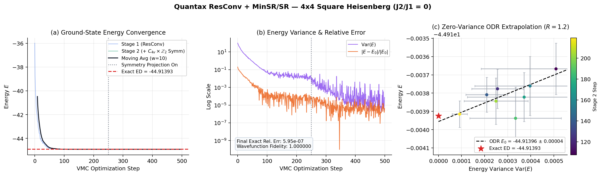
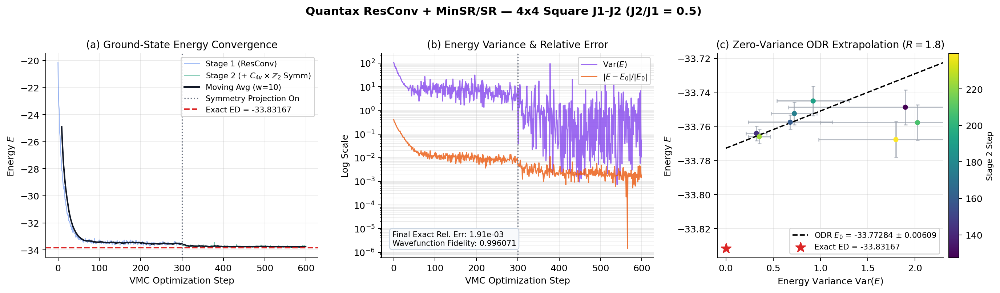

# NQS on Google Colab

**A lightweight, reproducible workflow for training and verifying Neural Quantum States (NQS) on Google Colab GPUs.**

Powered by **[Quantax v0.4](https://github.com/ChenAo-Phys/quantax)** (by **Ao Chen**, JAX + Equinox + QuSpin, for 2D frustrated quantum magnets with MinSR/SR & space-group symmetry projection) and **NetKet 3** (JAX + Flax, for RBM & Autoregressive Causal Transformer baselines), orchestrated headlessly via **`google-colab-cli`** on a lightweight remote Linux host with **Drive-free Weights & Biases** telemetry and automated secret-leak protection (`v0.3.0`).

---

## Verified Benchmark Results (Colab T4 GPU)

> **Credit & Tribute**: The 2D Square-Lattice Heisenberg and frustrated J<sub>1</sub>-J<sub>2</sub> benchmarks below—including the two-stage `ResConv` + `SR/MinSR` + C<sub>4v</sub> × ℤ<sub>2</sub> symmetry-projection workflow and the post-training diagnostic utilities (`measure`, `symm-test`, `zero-var-extrap`, `time-bench`)—are directly adapted from and pay tribute to **Ao Chen's** open-source **[ChenAo-Phys/quantax](https://github.com/ChenAo-Phys/quantax)** repository (see [`tutorials/J1J2.ipynb`](https://github.com/ChenAo-Phys/quantax/blob/main/tutorials/J1J2.ipynb) and its MIT-licensed `.agents/skills/`).

All benchmarks below were executed end-to-end on a single **Google Colab Pro+ NVIDIA T4 GPU** via the headless Colab CLI pipeline and verified against Exact Diagonalization (QuSpin / Lanczos ED).

### Summary Comparison

| System & Regime | Backend & Ansatz | Params | Exact ED E<sub>0</sub> | NQS Energy | Relative Error | Fidelity F | ⟨M<sub>stag</sub><sup>2</sup>⟩ (MC / ED) | Wall Time (T4) |
| :--- | :--- | ---: | ---: | :--- | ---: | ---: | :---: | ---: |
| **2D 4×4 Square Heisenberg** (J<sub>2</sub>/J<sub>1</sub> = 0) | Quantax `ResConv` (2×8) + `SR/MinSR` + C<sub>4v</sub> × ℤ<sub>2</sub> | 2,344 | `-44.913925` | `-44.913952` (dense)<br>`-44.913761 ± 7.3e-5` (MC) | **`5.95e-07`** | **`1.000000`** | `0.3634 ± 0.0025` / `0.3687` | 136 s |
| **2D 4×4 Frustrated J<sub>1</sub>-J<sub>2</sub>** (J<sub>2</sub>/J<sub>1</sub> = 0.5) | Quantax `ResConv` (`sinhp1_by_log`) + `SR/MinSR` + C<sub>4v</sub> × ℤ<sub>2</sub> | 2,344 | `-33.831669` | `-33.767036` (dense)<br>`-33.766033 ± 4.9e-3` (MC) | **`1.91e-03`** | **`0.996071`** | `0.2185 ± 0.0021` / `0.2135` | 175 s |
| **1D Critical TFIM** (L = 12, h = 1.0, PBC) | NetKet `RBM` (α = 2) + `SR` | 324 | `-15.322595` | `-15.322866 ± 2.7e-3` | **`1.77e-05`** | — | — | 36 s |
| **1D Critical TFIM** (L = 12, h = 1.0, PBC) | NetKet `CausalTransformer` (`gpt`, exact AR sampling) | 17,698 | `-15.322595` | `-15.272748 ± 1.6e-2` | **`3.25e-03`** | — | — | 112 s |

> **Notes**: Quantax Heisenberg energies follow the Pauli **σ**<sub>i</sub> · **σ**<sub>j</sub> convention of `quantax.operator.Heisenberg`; Fidelity F = |⟨ψ|ψ<sub>0</sub>⟩|<sup>2</sup> is computed against the exact QuSpin ground state; MC error bars are autocorrelation-corrected via streaming binning over 32,768 thermalized samples with zero frozen chains.

---

### 1. 2D 4×4 Square-Lattice Heisenberg Antiferromagnet (J<sub>2</sub>/J<sub>1</sub> = 0)

**Config**: [`configs/qtx_square4x4_heisenberg.yaml`](configs/qtx_square4x4_heisenberg.yaml) — adapted from [`ChenAo-Phys/quantax`](https://github.com/ChenAo-Phys/quantax) (`tutorials/J1J2.ipynb`): 250 steps unprojected `ResConv` + 250 steps C<sub>4v</sub> × ℤ<sub>2</sub> symmetry projection (`nsymm=16`), Marshall Sign Rule basis (`msr=True`), `nsamples=1024`.



* **Symmetry Projection Gain**: Activating C<sub>4v</sub> × ℤ<sub>2</sub> projection at step 250 drops Var(E) by **~3 orders of magnitude** (`1e-2 → 1e-5`), reaching exact variational relative error **`5.95e-07`** and **unit ground-state fidelity** (`1.000000` within fp32 precision).
* **Symmetry Overlap Diagnostic (`symm-test`)**: Bare `ResConv` confirms architecture-exact translation invariance (`trans_x = 1.0000 ± 0.0000`) and high approximate point-group overlaps (`rot90 = 0.9996`, `flip_x = 0.9995`, `spin_inv = 0.9996`); after projection, every group element reads **`1.0000 ± 0.0000`**.
* **Zero-Variance ODR Extrapolation (`odrpack`)**: Best window gives `E0_ODR = -44.913956 ± 0.000042` (`R = 1.2`); multi-window grid mean gives `-44.913996 ± 0.000085 (stat) ± 0.000074 (window)`, agreeing with Exact ED (`-44.913925`) within 1σ.
* **Autocorrelation Binning (`measure`)**: τ<sub>int</sub>(E) = `0.00`, τ<sub>int</sub>(M<sub>stag</sub><sup>2</sup>) = `0.42` (both plateaued; `sweep_scatter = 5.29e-4` vs expected `5.84e-4`, `zero_weight_samples = 0`).

---

### 2. 2D 4×4 Frustrated J<sub>1</sub>-J<sub>2</sub> Heisenberg Model (J<sub>2</sub>/J<sub>1</sub> = 0.5)

**Config**: [`configs/qtx_square4x4_j1j2.yaml`](configs/qtx_square4x4_j1j2.yaml) — adapted from [`ChenAo-Phys/quantax`](https://github.com/ChenAo-Phys/quantax) (`tutorials/J1J2.ipynb`): 300 steps unprojected `ResConv` (`final_activation=sinhp1_by_log` for non-positive frustrated sign structure) + 300 steps C<sub>4v</sub> × ℤ<sub>2</sub> symmetry projection, `SpinExchange(n_neighbor=[1, 2])`, `nsamples=1024`.



* **Frustrated Magnetism & Sign Structure**: At the maximally frustrated regime J<sub>2</sub>/J<sub>1</sub> = 0.5 where the Marshall Sign Rule is no longer exact, `sinhp1_by_log` + symmetry projection achieves **`1.91e-03`** relative error and **`0.996071`** ground-state fidelity with just **2,344 parameters**.
* **Physical Néel Order Suppression**: The staggered antiferromagnetic structure factor ⟨M<sub>stag</sub><sup>2</sup>⟩ = S<sub>z</sub>(π, π) / N drops sharply from **`0.3687`** (J<sub>2</sub> = 0) to **`0.2135`** (J<sub>2</sub> = 0.5) in Exact ED — accurately reproduced by both exact dense NQS (`0.2169`) and Monte Carlo binning (`0.2185 ± 0.0021`, τ<sub>int</sub> = `0.57`, plateaued).
* **Symmetry & Extrapolation Verification**: Pre-projection `symm-test` confirms approximate symmetry (`rot90 = 0.9889`, `flip_x = 0.9956`, `spin_inv = 0.9952`) → restored to **`1.0000 ± 0.0000`** post-projection. ODR zero-variance extrapolation (`res_var = 0.89`, `R = 1.8`, grid mean `-33.7800 ± 0.0111 (stat) ± 0.0070 (window)`) pushes the estimate closer to Exact ED while transparently exposing the finite-expressivity gap of a tiny 2-block CNN in the frustrated regime.

---

## Workflow Overview

* **Dual Physics Backends (`scripts/colab_remote_runner.py`)**: Automatically detects `backend:` in any YAML config (`quantax` vs `netket`), installs only the matching CUDA-13-safe environment on Colab, and runs each experiment in a clean subprocess with live streamed logs.
* **NQS Verification Toolkit (`.agents/skills/`)**: Reusable MIT-licensed Quantax diagnostic scripts and specifications (`measure`, `zero-var-extrap`, `symm-test`, `time-bench`) adapted from **[ChenAo-Phys/quantax](https://github.com/ChenAo-Phys/quantax)** for autocorrelation binning, symmetry overlap checks, and ODR extrapolation.
* **Quick Verification (`scripts/colab_quick.sh`)**: Reuses a hot Google Colab GPU session (`colab new` → `colab exec --timeout 0` → `colab stop`) for rapid iteration.
* **Unattended Batch Queue (`scripts/colab_queue.sh`)**: Runs sequential `colab run --timeout 0` jobs inside detached `tmux` on a remote Linux control host, auto-releasing each Colab GPU immediately on exit.
* **Drive-Free Telemetry & Watchdog (`Weights & Biases` + `monitor/gcp_watchdog.py`)**: Live curves, multi-panel figures, `.eqx`/`.mpack` checkpoints, and alerts on completion, disconnect, or `NaN` divergence.
* **Built-In Secret Guard (`scripts/check_secrets.py`)**: Pre-commit hook + test suite scanning tracked/staged files and Git history to block any API key, token, or credential file.

---

## Project Structure

```text
NQS/
├── README.md                        # Repository overview & verified benchmark showcase
├── docs/images/                     # High-resolution verified benchmark figures
├── .agents/skills/                  # Quantax MIT-licensed verification tools (`measure`, `zero-var-extrap`, `symm-test`, `time-bench`)
├── configs/
│   ├── qtx_square4x4_heisenberg.yaml # Quantax 2D 4x4 Square Heisenberg (J2=0, rel_err 5.95e-7, F=1.000000)
│   ├── qtx_square4x4_j1j2.yaml       # Quantax 2D 4x4 Frustrated J1-J2 (J2=0.5, rel_err 1.91e-3, F=0.9961)
│   ├── tfim_1d_rbm.yaml              # NetKet 1D Critical TFIM (L=12) + RBM + SR (rel_err 1.77e-5)
│   ├── tfim_1d_gpt.yaml              # NetKet Autoregressive Causal Transformer on 1D Critical TFIM (L=12)
│   └── heisenberg_1d_gpt.yaml        # NetKet Complex-phase Causal Transformer on 1D Heisenberg chain (L=12)
├── src/nqs/
│   ├── quantax_train.py             # Quantax v0.4 two-stage VMC + symmetry projection + W&B runner
│   ├── quantax_analysis.py          # BinningAccumulator, symm-test O_T, ODR extrapolation, 3-panel plots
│   └── config.py / physics.py / models.py / checkpoint.py / train.py  # NetKet 3 backend
├── scripts/
│   ├── colab_remote_runner.py       # Multi-backend Colab runner (auto-detects Quantax vs NetKet)
│   ├── colab_quick.sh               # Hot-GPU quick verification wrapper
│   ├── colab_queue.sh               # Detached tmux unattended batch queue (`colab run`)
│   ├── bootstrap_vm.sh              # Linux control host setup (2 GB swap, tmux, uv, google-colab-cli)
│   ├── check_secrets.py             # Automated API-key / credential leak scanner
│   └── install_git_hooks.sh         # Installs local `.git/hooks/pre-commit` secret guard
├── monitor/                         # Lightweight W&B heartbeat watchdog & systemd setup
├── notebooks/colab_runner.ipynb     # Verified browser fallback notebook for Google Colab
├── research/                        # Ongoing study: mixD bilayer vs trilayer t-J with NQS (see research/README.md)
└── tests/test_workflow_local.py     # Local test suite (security, syntax, configs, watchdog)
```

---

## Ongoing Research: Mixed-Dimensional Multilayer t-J Models

`research/` hosts a work-in-progress study comparing mixed-dimensional (mixD) **bilayer vs trilayer** t∥-J∥-J⊥ models with neural quantum states, motivated by the much lower T<sub>c</sub> of the trilayer nickelate La₄Ni₃O₁₀ compared with bilayer La₃Ni₂O₇ ("interlayer pairing frustration"). Stage 0 provides exact-diagonalization references for the half-filled (Heisenberg) limit on clusters up to 24 sites, validated against analytic limits. See [`research/README.md`](research/README.md).

---

## Reproducing Locally or on Colab

```bash
# 1. Install local pre-commit secret guard & run local checks
bash scripts/install_git_hooks.sh
python scripts/check_secrets.py
python tests/test_workflow_local.py

# 2. Run the 2D Quantax benchmarks directly (requires Python 3.11-3.13 + CUDA JAX + quantax[full] + odrpack)
PYTHONPATH=src python -u -m nqs.quantax_train --config configs/qtx_square4x4_heisenberg.yaml
PYTHONPATH=src python -u -m nqs.quantax_train --config configs/qtx_square4x4_j1j2.yaml
```
