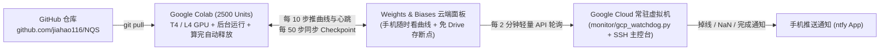

# 全流程操作手册：Colab GPU (2500 Units 免 Drive 版) + GCP 云端哨兵与主控台

本指南已针对你的账号资源完成定制：
* **GitHub 账号**：已自动关联你的本地 Git 用户名 **`jiahao116`**。
* **完全免 Google Drive**：所有收敛曲线、实验指标、断点续训文件（`.mpack`）全部走 **Weights & Biases (W&B)** 云端同步，省去每次弹窗授权 Google Drive 的麻烦。
* **Colab GPU 加速 + 2500 Compute Units 后台运行**：默认从最经典、在 GPU 上 20~40 秒就能收敛到 $10^{-5}$ 误差的 **1D 横场伊辛模型 + RBM + SR** 算例入手（同时仓库里也保留了自回归 Transformer 波函数供进阶对比），并内置**算完自动释放 GPU（`runtime.unassign()`）**开关，防止挂机白烧 Units。
* **GCP 每月 \$100 试用额度安全防扣费策略**：详细说明如何确认不扣信用卡，以及 `e2-micro`（纯免费）和 `e2-medium`（约 \$24/月额度，可直接当云端常驻开发机）的选型建议。

---

## 整体架构图（免 Google Drive 纯净版）



---

## 第一步：一键打开 Colab 跑通第一个 GPU NQS 实验

👉 **直达链接**：https://colab.research.google.com/github/jiahao116/NQS/blob/main/notebooks/colab_runner.ipynb

1. **选 GPU 与后台执行**：
   * 顶部 **`Runtime` -> `Change runtime type`**：入门算例选 **`T4 GPU`** 即可（每小时仅耗约 `1.2 ~ 2` Units，跑一次入门实验只花 **~0.02 Unit**！以后算大体系再开 `L4` / `A100`）。
   * 如界面有 **`Background execution`（后台执行）** 勾选框，勾上它——**勾上后哪怕家里电脑立刻断电断网，Colab 也会自己在云端跑完！**
2. **填一次 W&B 密钥（可选，但强烈推荐）**：
   * 打开 https://wandb.ai/authorize 复制免费 API Key。
   * 点击 Colab 左侧 **🔑 Secrets** 钥匙图标，添加 `WANDB_API_KEY`，粘贴 Key 并打开读取开关（如果先不想登录 W&B，把第 3 格的 `USE_WANDB` 取消勾选也能直接裸跑出图）。
3. **防白烧 Units 开关**：
   * 自己看着屏幕调试时：第 4 格保持 `AUTO_DISCONNECT_WHEN_DONE = False`。
   * 准备挂长任务离开电脑时：**勾选 `AUTO_DISCONNECT_WHEN_DONE = True`**——程序算完上传结果 5 秒后会调用 `runtime.unassign()` 自动释放 GPU 实例。
4. 点击 **`Runtime` -> `Run all`**！
   * 默认运行 `configs/tfim_1d_rbm.yaml`（12 自旋一维横场伊辛临界点 + 经典 RBM + 量子自然梯度 SR，约 **20~40 秒**）：程序会先用精确对角化算出真值 `E0 ≈ -15.3226`，随后画出变分能量逼近精确解红虚线的收敛图（误差可达 `1e-5` 量级）。
   * 也可以把第 4 格下拉框切到 `configs/tfim_1d_gpt.yaml` 或 `configs/heisenberg_1d_gpt.yaml` 对比现代自回归 Transformer 波函数！

---

## 第二步：Google Cloud 虚拟机配置与“绝不扣信用卡”双保险

### 2.1 先花 30 秒确认：怎么保证绝对不扣信用卡？
打开 [Google Cloud Billing 概览页](https://console.cloud.google.com/billing) 查看你的账单账户属性：
1. **情况 A：显示“免费试用（Free Trial）”或独立赠金账户（未点过升级付费账户）**
   * **天然防扣费**：额度花完自动停机，只要你不手动点 Upgrade 为正式付费账户，永远不会扣信用卡。
2. **情况 B：已升级为正式付费账户（Paid Account），每月发放 \$100 Credit**
   * 超过 \$100 的部分会扣卡。请立刻在左侧 **`Budgets & alerts` -> `Create Budget`** 建一个 **\$50 预算告警**兜底。只要只跑下面推荐的监控/开发机，每月只耗 **\$0 ～ \$24 额度**，非常安全。

### 2.2 虚拟机规格怎么选？
* **选项 1（纯 \$0 永久免费）：`e2-micro`**（2 vCPU, 1 GB 内存，`us-central1`/`us-west1`/`us-east1`，20 GB 标准永久磁盘）。只跑后台监控哨兵 `gcp_watchdog.py`，不花一分钱额度。
* **选项 2（推荐，月耗约 \$24 试用额度）：`e2-medium`**（2 vCPU, **4 GB 内存**，30 GB 磁盘）。除了 7×24 小时跑哨兵，4 GB 内存足够你用 **Remote-SSH** 直接把开发环境和我（AI 助手）常驻在云端，家里电脑断电重连后上下文不丢。

### 2.3 在 GCP 虚拟机上一键启动 24 小时哨兵
SSH 登录虚拟机后运行：
```bash
git clone https://github.com/jiahao116/NQS.git
cd NQS
export WANDB_API_KEY="paste_your_wandb_api_key_here"
export NTFY_TOPIC="nqs-jiahao116-random1234"
bash monitor/setup_gcp_vm.sh
```
随时打印所有 Colab 实验汇总表：
```bash
.venv-monitor/bin/python monitor/gcp_watchdog.py --once --markdown
```
