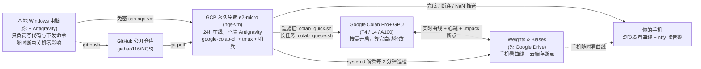

# NQS 云端双流程操作手册（v0.2.0 正式运行版）

> 本文档始终与当前仓库架构同步；任何过时步骤已清除。面向新接手 AI Agent 的完整技术交接规范请见根目录 **[AGENTS.md](../AGENTS.md)**。

---

## 第一原则：安全与防扣费红线（永远排第 1 位）

本仓库为 **GitHub 公开仓库**，每次改代码与提交必须死守以下底线：
1. **绝不提交任何密钥与隐私文件**：`WANDB_API_KEY`、GCP 凭据 JSON、SSH 密钥、`.env`、真实 `NTFY_TOPIC`、GCP 项目 ID 与虚拟机外网 IP 均保存在仓库外（本地 `~/.ssh/` 或虚拟机本地 `~/NQS/.env`），**绝不写入 Git**。
2. **三道自动防泄密门禁**：
   * `.gitignore` 屏蔽所有 `.env*`、`*.key`、`*.pem`、`*credentials*.json`、`monitor/monitor_config.yaml` 等文件；
   * 本地 Git `pre-commit` 钩子在每次 `git commit` 前自动运行 `scripts/check_secrets.py --staged`，一旦发现疑似 API Key 立刻拦截提交；
   * 本地自测 `python tests/test_workflow_local.py` 每次都会执行全仓密钥扫描与代码纯英文检查。
3. **不乱烧算力与信用卡**：
   * 短验证用完热 GPU 立刻 `colab_quick.sh stop`；
   * 长任务走 `colab_queue.sh`（底层 `colab run` 跑完自动销毁 GPU）；
   * GCP 虚拟机固定使用永久免费档 `e2-micro`（`us-central1` + 20 GB 标准永久盘 + 2 GB Swap），且账户已设 \$1 账单告警兜底。

---

## 当前运行架构总览（方案 A：无浏览器双流程）



---

## 日常双流程操作速查

> 日常只需在本地直接用中文告诉 Antigravity 你想跑什么实验，以下为底层执行的标准命令参考。

### 流程 ①：短时间验证 / 快速试错（复用热 GPU，几十秒出结果）
```powershell
# 1. 启动一个热 Colab GPU 会话（可选 T4 / L4 / A100）
ssh nqs-vm 'bash NQS/scripts/colab_quick.sh start T4'

# 2. 快速执行验证（自动拉最新 GitHub 代码，首次后跳过 pip install，日志实时回显）
ssh nqs-vm 'bash NQS/scripts/colab_quick.sh run configs/tfim_1d_rbm.yaml --fresh'

# 3. 测完务必关闭热会话释放 GPU，停止消耗 Units！
ssh nqs-vm 'bash NQS/scripts/colab_quick.sh stop'
```

### 流程 ②：长时间计算 / 批量扫参数（`tmux` 后台托管，下发后可立刻关电脑）
```powershell
# 1. 提交任务队列到虚拟机后台 tmux（每个任务用 `colab run` 跑完自动销毁 GPU）
ssh nqs-vm 'bash NQS/scripts/colab_queue.sh submit T4 configs/tfim_1d_rbm.yaml configs/tfim_1d_gpt.yaml'

# 2. 随时查看队列运行状态与最新日志
ssh nqs-vm 'bash NQS/scripts/colab_queue.sh status'

# 3. 如需中途取消队列
ssh nqs-vm 'bash NQS/scripts/colab_queue.sh stop'
```

### 常用监控与维护命令
```powershell
# 查看 Colab Compute Units 余额 & 确认没有遗漏挂机的 GPU
ssh nqs-vm '~/.local/bin/colab --auth=adc usage && ~/.local/bin/colab --auth=adc sessions'

# 拉取最近所有 W&B 实验的 Markdown 汇总表
ssh nqs-vm 'set -a; source NQS/.env; set +a; NQS/.venv-monitor/bin/python NQS/monitor/gcp_watchdog.py --config NQS/monitor/monitor_config.yaml --once --markdown'

# 查看 24 小时哨兵运行状态与实时日志
ssh nqs-vm 'systemctl status nqs-watchdog.service --no-pager'
ssh nqs-vm 'journalctl -u nqs-watchdog -n 30 --no-pager'
```

---

## 网页手动备用入口（无需本地电脑）
万一在外只想纯用手机/平板临时点一下运行，依然可直接打开已验证通过的免 Drive 版网页工作台（注意：**只运行，不要点 Colab 顶部的“保存到 GitHub”**）：
* https://colab.research.google.com/github/jiahao116/NQS/blob/main/notebooks/colab_runner.ipynb

---

## 换新电脑或重装环境时的恢复步骤
1. 克隆仓库并安装本地防泄密 Git 钩子：
   ```bash
   git clone https://github.com/jiahao116/NQS.git
   cd NQS
   bash scripts/install_git_hooks.sh
   ```
2. 把本机 `~/.ssh/config` 配好 `Host nqs-vm` 即可恢复对云主机与 Colab GPU 的全部操控。
3. 若需重新初始化一台全新的 GCP Ubuntu `e2-micro` 虚拟机，在虚拟机里依次运行 `scripts/bootstrap_vm.sh`、一次性 `gcloud auth application-default login` 授权、以及 `monitor/setup_gcp_vm.sh` 即可完整复原。
