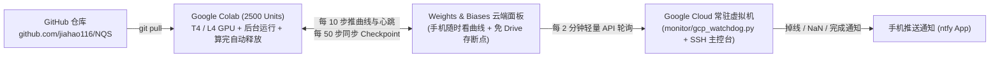

# 全流程操作手册：Colab (2500 Units 免 Drive 版) + GCP 云端哨兵与主控台

本指南已针对你的账号资源完成定制：
* **GitHub 账号**：已自动关联你的本地 Git 用户名 **`jiahao116`**。
* **完全免 Google Drive**：所有收敛曲线、实验指标、断点续训文件（`.mpack`）全部走 **Weights & Biases (W&B)** 云端同步，省去每次弹窗授权 Google Drive 的麻烦。
* **Colab 2500 Compute Units 后台运行 + 自动省电**：支持开启后台执行（家里电脑断电照样算），并内置了**算完自动释放 GPU（`runtime.unassign()`）**开关，防止挂机白烧 Units。
* **GCP 每月 \$100 试用额度安全防扣费策略**：下面详细说明如何确认不扣信用卡，以及在 `e2-micro`（纯免费）和 `e2-medium`（月耗约 \$24 额度，可直接当云端常驻开发机）之间选择。

---

## 整体架构图（免 Google Drive 纯净版）



---

## 第一步：在 GitHub 新建空仓库并推送（1 分钟）

本地 Git 仓库已经帮你初始化好了，只需在网页建个空壳再推上去：
1. 浏览器打开 https://github.com/new ，Repository name 填 **`NQS`**（设为 Public 最省事，**不要**勾选 Add a README），点 **Create repository**。
2. 在本地终端运行：
   ```powershell
   git remote add origin https://github.com/jiahao116/NQS.git
   git push -u origin main
   ```

---

## 第二步：获取 W&B API Key（替代 Google Drive 的核心枢纽）

1. 用 Google 账号登录 https://wandb.ai 。
2. 打开 https://wandb.ai/authorize 复制你的 **API Key**。
3. 以后无论本地电脑是否断电关机，手机浏览器打开 `https://wandb.ai` 就能实时看到基态能量收敛曲线！

---

## 第三步：在 Google Colab 跑通第一个 GPT-NQS 实验（保护 2500 Units 技巧）

1. 打开 https://colab.research.google.com -> **`GitHub`** 标签页 -> 打开 `jiahao116/NQS` 里的 `notebooks/colab_runner.ipynb`。
2. **选 GPU 与后台执行**：
   * 顶部 **`Runtime` -> `Change runtime type`**：入门算例选 **`T4 GPU`** 即可（每小时仅耗约 `1.2 ~ 2` Units，跑一次入门实验只花 **~0.03 Unit**！以后算大体系再开 `L4` / `A100`）。
   * 如果界面有 **`Background execution`（后台执行）** 勾选框，勾上它——**勾上后哪怕你家里的电脑立刻断电断网，Colab 也会在云端自己跑完！**
3. **填一次密钥**：点击左侧 **🔑 Secrets** 钥匙图标，添加 `WANDB_API_KEY`，粘贴刚才复制的 Key 并打开读取开关。
4. **防白烧 Units 开关**：
   * 自己看着屏幕调试时：第 4 格保持 `AUTO_DISCONNECT_WHEN_DONE = False`。
   * 准备挂长任务离开电脑（或怕家里断电）时：**勾选 `AUTO_DISCONNECT_WHEN_DONE = True`**——程序一旦算完并把结果上传到 W&B，5 秒后会**自动销毁释放 Colab GPU 实例**，绝不空转浪费你的 2500 Units！
5. 点击 **`Runtime` -> `Run all`**，约 1 分钟即可看到 GPT 波函数能量贴合到精确对角化标准答案（`-15.3226`）红虚线上！

---

## 第四步：Google Cloud 虚拟机配置与“绝不扣信用卡”双保险

### 4.1 先花 30 秒确认：怎么保证绝对不扣信用卡？
打开 [Google Cloud Billing 概览页](https://console.cloud.google.com/billing) 查看你的账单账户属性：
1. **情况 A：显示“免费试用（Free Trial）”或独立教育/赠金账户（未点过升级付费账户）**
   * **天然防扣费**：Google 的机制是试用金花完自动停机，**只要你不手动点 Upgrade 为正式付费账户，永远不可能扣信用卡一分钱**。
2. **情况 B：已升级为正式付费账户（Paid Account），但每月发放 \$100 抵扣额度（Credits）**
   * 这种情况下**用超 \$100 的部分会扣卡**。请立刻在左侧点 **`Budgets & alerts`（预算和提醒） -> `Create Budget`**：将预算金额设为 **\$50**（远低于你的 \$100 额度），勾选 50%、90%、100% 邮件告警。只要我们只开下面推荐的小虚拟机，一个月总共只消耗 **\$0 ～ \$24 额度**，连预算的一半都碰不到！

### 4.2 虚拟机规格怎么选？
* **选项 1（纯 \$0 永久免费）：`e2-micro`**（2 vCPU, 1 GB 内存，`us-central1`/`us-west1`/`us-east1`，20 GB 标准永久磁盘 Standard persistent disk）。只跑后台监控哨兵 `gcp_watchdog.py`，一分钱额度都不花。
* **选项 2（最契合你“本地经常断电”痛点，消耗约 \$24/月试用额度）：`e2-medium`**（2 vCPU, **4 GB 内存**，30 GB 磁盘）。
  * 不仅能 7×24 小时跑哨兵监控 Colab，而且 **4 GB 内存足够你用 VS Code / Antigravity 直接通过 Remote-SSH 连上去当云端主控台开发**！家里电脑突然断电也没关系，来电重连 SSH 后，我（AI 助手）和你的实验环境在云端毫发无损。

### 4.3 在 GCP 虚拟机上一键启动 24 小时哨兵
SSH 登录虚拟机后运行 5 行命令即可完成部署（`ntfy` 手机推送免注册，在手机装个 `ntfy` App 订阅同名频道即可）：
```bash
git clone https://github.com/jiahao116/NQS.git
cd NQS
export WANDB_API_KEY="粘贴你的_WANDB_API_KEY"
export NTFY_TOPIC="nqs-jiahao116-改成随机数字"
bash monitor/setup_gcp_vm.sh
```
以后你想让我检查所有 Colab 任务进度时，只需让我执行：
```bash
.venv-monitor/bin/python monitor/gcp_watchdog.py --once --markdown
```
就能立刻拉出所有实验的能量、相对误差、V-score 和健康状态汇总表！
