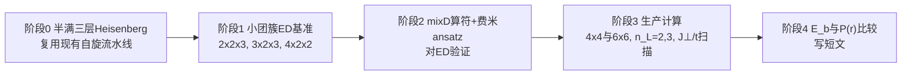

# 选题建议：三层镍氧化物中的"层间配对受挫"，用 NQS 做受控检验

**一句话：** 把 Lange, **Ao Chen**, Georges, Grusdt, Bohrdt, Roth 的混合维度（mixD）双层 t∥-J∥-J⊥ NQS 研究（arXiv:2602.10091，2026 年 2 月）推广到**三层**（对应 La₄Ni₃O₁₀），在同一个 Hamiltonian、同样大小的团簇上直接比较 n_L = 2 和 n_L = 3，定量检验"层间配对受挫导致三层 Tc 低于双层"这个假说。

---

## 1. 为什么选这个

| 标准 | 判断 |
| :--- | :--- |
| **新鲜** | 用 NQS 算 mixD 双层是 2026 年 2 月才有的工作（作者称是首个多轨道费米 NQS 模拟）。目前检索到的三层 mixD 研究只有 DMRG/平均场，**没找到三层的 NQS 研究**（开工前请再做一次 arXiv 查新，见 §6）。 |
| **科研价值** | 有实验反常可以对照：在铜氧化物里多层通常让 Tc **升高**（三层最高），镍氧化物却是三层 La₄Ni₃O₁₀（约 20–30 K）**远低于**双层 La₃Ni₂O₇（约 80 K）。已有人提出"层间配对受挫"的唯象解释（Qin 等，*The Innovation*），但缺少无偏的 2D 数值检验。这个问题清楚、可以被证伪，物理图像也直观。 |
| **贴合 Ao Chen 的路线** | 他的路线图 Milestone 3 是"在类 Hubbard 模型中拿到高温超导的可靠数值证据"，也明确写了 **"AI for physics → material design"**。最新的 Hubbard 工作（arXiv:2610.30321）强调"每种 ansatz 都有自带偏置"。三层与双层的**相对比较**能抵消大部分 ansatz 偏置和有限尺寸偏置，正好接上他的方法论关切。 |
| **算力低** | 少空穴扇区（0/1/2 个空穴）加 4×4×{2,3}、6×6×{2,3} 小团簇，Pfaffian/行列式只有几十维。粗估总量是**十几到二十几个 T4/L4 GPU 小时**；对比之下，Hubbard 1/8 掺杂条纹问题需要 A100 80GB 和 NERSC 量级的算力。 |
| **力所能及** | quantax 已有 `tJ`、`Grid(..., double_occ=False)`（Gutzwiller 投影空间）、`DetBackflow` / `PfBackflow`、`UnrestrictedDet`（N↑≠N↓，用于 1 空穴扇区）、`PartialPair`（未配对轨道），以及 QuSpin 精确对角化。半满极限就是三层 Heisenberg 模型，**直接复用现有的 ResConv + SR + 对称投影流水线**。 |

---

## 2. 模型

$$
H=-t_\parallel\sum_{\ell,\langle ij\rangle,\sigma}\mathcal P\left(c^\dagger_{i\ell\sigma}c_{j\ell\sigma}+\mathrm{h.c.}\right)\mathcal P
+J_\parallel\sum_{\ell,\langle ij\rangle}\left(\mathbf S_{i\ell}\cdot\mathbf S_{j\ell}-\tfrac14 n_{i\ell}n_{j\ell}\right)
+J_\perp\sum_{i}\sum_{\ell=1}^{n_L-1}\left(\mathbf S_{i\ell}\cdot\mathbf S_{i,\ell+1}-\tfrac14 n_{i\ell}n_{i,\ell+1}\right)
+\sum_{i\ell}\epsilon_\ell n_{i\ell}
$$

- mixD 的含义：**层间没有跳跃（t⊥ = 0）**，只有层间交换 J⊥。
- n_L = 2（双层，用来复现文献）对比 n_L = 3（三层）。
- 可选参数 ε_inner：内层与外层的位能差，对应真实材料中内外层载流子密度不等。
- quantax 自带的 `tJ()` 只支持"第 n 近邻"统一耦合，mixD 需要**自定义成键**。用 `create_u/annihilate_d/number_u` 等算符拼起来大约 30 行，`tJ()` 的源码可以直接当模板。

## 3. 核心观测量（都很便宜）

1. **配对结合能**：$E_b(n_L) = E(N_h{=}2) + E(0) - 2E(1)$，按每个"层柱"归一化后比较双层和三层。E_b < 0 表示空穴成对。
2. **层分辨配对关联** $P_{\ell\ell'}(r)=\langle\Delta^\dagger_{\ell\ell'}(0)\Delta_{\ell\ell'}(r)\rangle$，其中 $\Delta_{\ell\ell'}(i)=c_{i\ell\uparrow}c_{i\ell'\downarrow}-c_{i\ell\downarrow}c_{i\ell'\uparrow}$。三层分别看 (1,2)、(2,3)、(1,3) 通道及其层宇称组合，这是"受挫"的直接指纹。
3. **层分辨空穴–空穴关联** $g_{\ell\ell'}(r)$，给出配对尺寸，用来区分 BEC 型和 BCS 型。
4. **半满层间单态权重** $\langle\mathbf S_\ell\cdot\mathbf S_{\ell+1}\rangle$：内层被两侧"争夺"的程度（纯自旋问题，第 0 阶段就能出结果）。

## 4. 分阶段计划

| 阶段 | 内容 | 估计算力 |
| :--- | :--- | :--- |
| 0 | 4×4×3 半满 Heisenberg（ResConv + MinSR + 对称投影），用 QuSpin ED 校验 2×2×3、3×3×2 | 不到 1 T4·h |
| 1 | 12–18 格点 t-J 团簇 ED（0/1/2 个空穴），作为"真值"基准 | 只用 CPU |
| 2 | 自定义 mixD 算符，`DetBackflow` / `PfBackflow` + `double_occ=False`；在 ED 团簇上把相对误差压到 1e-3 以下 | 约 2 T4·h |
| 3 | 4×4×{2,3}、6×6×{2,3}；J⊥/t ∈ {0.5, 1, 2, 4}；N_h ∈ {0, 1, 2}；外加 1/8 掺杂的一个点看 P(r) | 约 10–20 GPU·h（用 `colab_queue.sh` 批量提交） |
| 4 | 用 binning 给误差棒（`measure` skill），用零方差外推（`zero-var-extrap` skill）修正 E_b 这种"小差值"量 | 很少 |

**最低可发表结果：** "在相同 J⊥/t 下，三层的 |E_b| 和层间 P(r) 相对双层被系统性压低（或者没有被压低）"，加上 ED 基准和尺寸趋势。不管结论是肯定还是否定，都可以写成 PRB/PRR 短文。

## 5. 和现有基础设施的对接

- YAML 增加 `system.model: mixd_tj`、`n_layers`、`J_perp`、`n_holes`，沿用 `backend: quantax` 自动分发。
- `src/nqs/quantax_analysis.py` 里已有 binning、对称重叠和 ODR 外推，可以直接复用。
- quantax 仓库自带的 d 波配对测量脚本（`measure/dwave/`），改成层间 s 波通道就能用。
- 注意 Quantax "每进程只能有一个 `Sites`"：每个 (n_L, N_h, J⊥) 组合各跑一个子进程，现有 runner 已经这样处理。

## 6. 风险与对策

> [!WARNING]
> **时效性。** 三层是双层工作的自然延伸，其他组也可能在做。对策：定期复查 arXiv（关键词 "trilayer mixed-dimensional neural quantum states"、"La4Ni3O10 t-J variational"）；范围收窄到"双层 vs 三层受控比较 + 结合能"，尽快推进。

- **1 空穴扇区（N↑≠N↓）**：Pfaffian 需要处理未配对轨道，可以先用 `DetBackflow` / `UnrestrictedDet` 绕过，或者用 `PartialPair`。
- **小团簇有限尺寸效应**：结论建立在**相对比较**（同团簇、同参数下的 n_L = 2 对 n_L = 3）上，并给出 4×4 → 6×6 的趋势，不声称热力学极限下的绝对 Tc。
- **E_b 是小差值**：每个扇区的能量误差必须远小于 |E_b|，所以阶段 2 的 ED 验证和零方差外推不能跳过。

## 7. 备选方向（更保守、算力更低）

**NQS 的"学习难度标度律"作为相变探针。** Rende 等（arXiv:2606.02794，2026 年 6 月）发现 V-score 随训练算力呈幂律下降，且指数随阻挫增大而减小。可以做的低成本延伸：在**有 ED 真值**的 4×4、6×6 J1-J2 体系上，用精确保真度代替 V-score；比较 ResConv 和 Transformer 的指数是否普适；看指数随 J2 是否在相变点附近出现极值。完全复用现有自旋流水线，每次运行几分钟，适合用队列批量跑。物理价值低于主方向，但几乎零风险，可以作为练手或副线。

## 8. 排除的方向（及原因）

- **Hubbard 1/8 掺杂的条纹与 d 波竞争**（Ao Chen 的主战场）：需要 16×16 以上的格点和 A100 80GB，超出我们的算力。
- **Kagome 无能隙自旋液体**（arXiv:2611.18840）：同样需要大尺寸和大模型，而且已有顶级组在做。
- **化学 / 基础模型 NQS**：和现有的 quantax 自旋/费米流水线及 Ao Chen 的路线关联较弱。

---

## 9. 查新结果（2026-11-22）

> [!IMPORTANT]
> 结论：**目前没有检索到"三层 mixD t-J 模型 + NQS"或"二维双层 vs 三层受控 NQS 比较"的工作**，这个空白看起来是真实的。但检索覆盖不完整（见下方"检索局限"），立项前请手动跑一遍 arXiv。

| 已有工作 | 方法 | 和本选题的关系 |
| :--- | :--- | :--- |
| Lange, Chen, Georges, Grusdt, Bohrdt, Roth, arXiv:2602.10091 | NQS（Gutzwiller 投影 HFPS），mixD **双层**，最大 8×8×2 | 直接前序工作，**只做了双层** |
| 同组的 Emery 模型 NQS 降维（检索摘要给出的编号是 arXiv:2609.38150，待核实） | NQS（HFDS），三带 Emery 模型 | 同组的新方向，不涉及三层 |
| Kuroki 组（Kakoi 等） | DMRG，**三腿梯子**（准一维），约 1/3 填充 | 发现空穴掺杂后配对关联呈幂律衰减；局限在准一维 |
| Chen 等，arXiv:2508.06802（待核实） | DMRG，两轨道三层模型（准一维几何） | 发现 Hund 耦合很重要；多轨道，不是 mixD |
| Huang & Zhou，arXiv:2404.09162（PRB 110, L060506） | 三层平均场 | 层间配对为主，部分费米面无能隙 |
| Qin, Wang, Yang（*The Innovation Materials*） | 唯象 / 强耦合理论 | **提出了"层间配对受挫"**，但缺少无偏的二维数值检验 |

**由此修正的定位：** 用"**首个二维（非梯子）无偏 NQS，在同一 mixD 模型下受控比较双层与三层**"来定位，**直接检验 Qin 等的受挫假说**。补充建议：参考 Kuroki 组的结果，在掺杂扫描中加入"1/3 填充附近的空穴掺杂"这一点。

**检索局限：**
- 未能直接调用 arXiv API 检索。
- 最终只靠网页检索摘要完成，覆盖不完整，个别编号可能有误。
- 请手动确认以下三个检索（每个约 1 分钟）：
  - 作者最新文章：https://arxiv.org/search/?query=Lange%2C+Hannah&searchtype=author 、https://arxiv.org/search/?query=Roth%2C+Christopher&searchtype=author 、https://arxiv.org/search/?query=Bohrdt&searchtype=author
  - https://arxiv.org/search/?query=trilayer+neural+quantum+states&searchtype=all
  - https://arxiv.org/search/?query=trilayer+mixed-dimensional&searchtype=all

### 来源说明
- **已核实**（Ao Chen 主页与 NeuralHubbard README）：arXiv:2602.10091、2610.30321、2611.26604，以及路线图里程碑的描述。
- **来自网络检索摘要、尚未逐篇打开原文**：arXiv:2606.02794（标度律）、2611.18840（Kagome）、Qin 等关于"层间配对受挫"的工作、La₄Ni₃O₁₀ 与 La₃Ni₂O₇ 的 Tc 数值。正式立项前请打开原文逐一核对。
